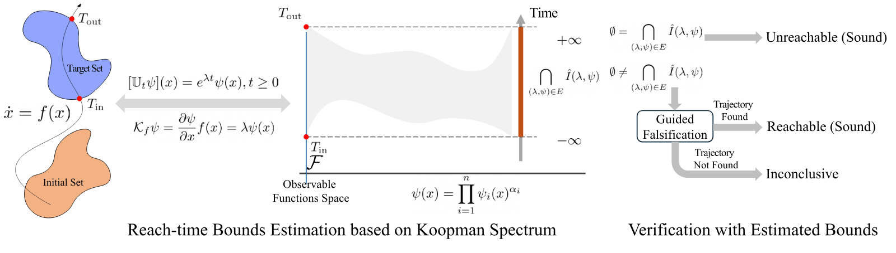

<h1 align="center">Time-to-Reach Verification Using the Koopman Spectrum</h1>

<p align="center"><b>Online report: <a href="https://aalto-nonlinear-systems-and-control.github.io/Time-to-Reach/">https://aalto-nonlinear-systems-and-control.github.io/Time-to-Reach/</a></b></p>

<p align="center"><b>Benchmark specifications (PDF): <a href="Benchmark_Specifications.pdf">Benchmark_Specifications.pdf</a></b></p>

<p align="center"></p>

This repository holds the code, the benchmarks and the results of the paper _Time-to-reach Bounds for Verification of Dynamical Systems Using the Koopman Spectrum_ by Jianqiang Ding and Shankar A. Deka.

## Contents

- [Contents](#contents)
- [Reproducing the paper](#reproducing-the-paper)
  - [Environment](#environment)
  - [Table II: comparison of the tools](#table-ii-comparison-of-the-tools)
  - [Figures](#figures)
- [Benchmarks](#benchmarks)
- [Results](#results)
- [Tool settings](#tool-settings)
- [Tests](#tests)
- [Repository layout](#repository-layout)

## Reproducing the paper

The repository holds the following parts of the paper:

| Part                                                                                       | Folder             | In the paper               |
| ------------------------------------------------------------------------------------------ | ------------------ | -------------------------- |
| KRTB, the method of the paper: reach-time bounds from the principal Koopman eigenfunctions | `tools/krtb/`      | Examples 1–3, Table II     |
| Runners for the five compared tools: CORA, JuliaReach, dReach, hj_reachability, SOSTOOLS   | `tools/`           | Table II                   |
| The 16 benchmarks as JSON configs, and the settings of every tool                          | `configs/`         | Table II                   |
| The results of every tool, and the simulation baseline they are checked against            | `results/summary/` | Tables I and II            |
| The scripts that write the tables and figures                                              | `scripts/`         | Tables I and II, Figs. 2–4 |

### Environment

```sh
git clone --recurse-submodules \
    https://github.com/Aalto-Nonlinear-Systems-and-Control/Time-to-Reach.git
cd Time-to-Reach
mamba env create -f environment.yml   # Python 3.12 with pinned packages
conda activate time_to_reach
```

KRTB, the simulation baseline, HJ and all scripts need only this environment. KRTB solves small linear-fractional programs with MOSEK through cvxpy. MOSEK needs a licence file, by default at `~/mosek/mosek.lic`; academic licences are free. The other tools need:

| Tool       | Needs                                                                                                                                                                      |
| ---------- | -------------------------------------------------------------------------------------------------------------------------------------------------------------------------- |
| CORA       | MATLAB R2025a, found through `$MATLAB_BIN`, `/Applications/MATLAB_R2025a.app` or `matlab` on the `PATH`. CORA v2026.1.0 is the submodule `tools/cora/CORA`.                |
| SOSTOOLS   | MATLAB R2025a with MOSEK for MATLAB; the results were computed with MOSEK 11.0.25. SOSTOOLS v4.03 is the submodule `tools/sosbc/SOSTOOLS`.                                 |
| JuliaReach | Julia 1.13.1 (for example with juliaup), then `julia --project=tools/juliareach -e 'using Pkg; Pkg.instantiate()'`.                                                        |
| dReach     | Docker. Build the image with `docker build --platform linux/amd64 -t dreach:dreal3-7f31797b tools/dreach`. It is x86-64 only, so it runs under emulation on Apple Silicon. |

All commands below run from the repository root in the `time_to_reach` environment.

### Table II: comparison of the tools

```sh
# simulation baseline -> results/summary/ground_truth/
python -m scripts.check_benchmarks
# KRTB on all benchmarks -> results/summary/krtb/
python -m tools.krtb.run --all
# the same for juliareach, dreach, hj and sosbc
python -m tools.cora.run --all
# check every result against the simulation baseline
python -m scripts.evaluate_results
# Table II (paper_table.tex) and Table I (paper_table_mas.tex)
python -m scripts.paper_table
# every verdict with its timing breakdown (table.md, .csv, .tex)
python -m scripts.aggregate
```

Each runner also takes `--benchmark ID` for a single benchmark. A runner writes one record per benchmark to `results/summary/<tool>/<ID>/setting_0.json`. A record holds the verdict, the reach-time bounds, the timings, the parameters and the provenance (commit, platform, versions).

`scripts.evaluate_results` compares each record with the simulation baseline. It exits with an error if a tool claims "unreachable" for a benchmark that a simulated trajectory reaches. The tables in `results/summary/` are generated from the records.

### Figures

```sh
# Fig. 2 (Duffing) and Fig. 4 (cart-pole) -> results/figures/
python -m scripts.paper_figures
# Fig. 3, robustness to eigenfunction errors -> results/robustness/
python -m scripts.robustness
```

The figures are drawn from the stored KRTB results and from freshly simulated trajectories. Next to every figure is a JSON file with the data it was drawn from.

The robustness study perturbs the eigenfunction values with multiplicative noise and recomputes the bounds with the KRTB code. The details are in the docstring of [`scripts/robustness.py`](scripts/robustness.py).

## Benchmarks

The 16 benchmarks come from five systems:

<div align="center">

| System                            | Benchmarks  | Dim |
| --------------------------------- | ----------- | --- |
| Duffing oscillator (Example 1)    | `DUFF_*`    | 2   |
| Stable limit cycle                | `NL-SLC_*`  | 2   |
| Saddle point system               | `NL-EIG_*`  | 2   |
| Cart-pole (Example 2)             | `CP-LQR_*`  | 4   |
| Multi-agent consensus (Example 3) | `MAS-CON_*` | 16  |

</div>

Names in the paper and config IDs (`configs/benchmarks/`):

<div align="center">

| Name in the paper<br>Config ID                         | Initial → target set             | Horizon  | Expected    |
| ------------------------------------------------------ | -------------------------------- | -------- | ----------- |
| DUFF_REA_BOX<br>`DUFF_FIN_REA_BOX`                     | box → box                        | [0, 6]   | reachable   |
| DUFF_REA_CVX_LS<br>`DUFF_FIN_REA_BALL`                 | ball → ball                      | [0, 6]   | reachable   |
| DUFF_REA_NCVX_LS<br>`DUFF_FIN_REA_NONCONVEX_LEVEL_SET` | level set → non-convex level set | [0, 6]   | reachable   |
| DUFF_REA_DSJT_BOX<br>`DUFF_FIN_REA_DISJOINT_BOX`       | box → two disjoint boxes         | [0, 6]   | reachable   |
| DUFF_UNR_BOX<br>`DUFF_FIN_UNR_BOX`                     | box → box                        | [0, 20]  | unreachable |
| DUFF_UNR_CVX_LS<br>`DUFF_FIN_UNR_BALL`                 | ball → ball                      | [0, 6]   | unreachable |
| NL-SLC_REA_BOX<br>`NL_SLC_FIN_REA_BOX`                 | box → box                        | [0, 15]  | reachable   |
| NL-SLC_UNR_BOX<br>`NL_SLC_FIN_UNR_BOX`                 | box → box                        | [0, 15]  | unreachable |
| NL-EIG_BWD_REA_BOX<br>`NL_EIG_FIN_BACKWARD_REA_BOX`    | box → box (backward problem)     | [0, 1.3] | reachable   |
| NL-EIG_BWD_UNR_BOX<br>`NL_EIG_FIN_BACKWARD_UNR_BOX`    | box → box (backward problem)     | [0, 1.3] | unreachable |
| CP-LQR_REA_CVG<br>`CP_LQR_FIN_REA_CONVERGE`            | point → box shell at the origin  | [0, 12]  | reachable   |
| CP-LQR_REA_USF<br>`CP_LQR_FIN_REA_UNSAFE`              | point → wall p + l sin θ > 1.3   | [0, 10]  | reachable   |
| CP-LQR_UNR_SAF<br>`CP_LQR_FIN_UNR_SAFE`                | point → wall p + l sin θ > 3.7   | [0, 10]  | unreachable |
| MAS-CON_REA_BOX<br>`MAS_CON_FIN_REA_BOX`               | box → box shell at the origin    | [0, 7]   | reachable   |
| MAS-CON_UNR_SAF_0<br>`MAS_CON_FIN_UNR_SAFE_0`          | box → box                        | [0, 7]   | unreachable |
| MAS-CON_UNR_SAF_1<br>`MAS_CON_FIN_UNR_SAFE_1`          | box → box                        | [0, 7]   | unreachable |

</div>

How to read the table:

- **Expected result.** "Reachable" means that some trajectory from the initial set enters the target within the horizon. "Unreachable" means that none does.
- **Box shells.** A box shell at the origin is the box ‖x‖∞ ≤ R without the open box ‖x‖∞ < 10⁻³⁰, so it excludes the equilibrium. R is 10⁻³ for the cart-pole and 0.1 for the multi-agent system.
- **Simulation baseline.** `scripts.check_benchmarks` confirms every expected result by simulation. It also records the simulated in-target times, which are used to judge the reach-time bounds.

**The cart-pole (Example 2):**

- **Model.** Tedrake's cart-pole. The pole angle is measured counter-clockwise from the hanging vertical; the origin is the hanging equilibrium.
- **Controller.** The LQR feedback F = −Kx with K = [2.907, 4.877, −3.770, −1.640], designed for the linearisation at the hanging equilibrium with Q = diag(56.5349, 27.434, 1.8689, 77.9197) and R = 6.6884.
- **Sets.** The initial set is the single state x0 = (0.8, 0.3, −π/4, 0.2). The wall targets are restricted to the box X = [−0.06, 4] × [−0.88, 0.7] × [−0.83, 0.66] × [−1.72, 2.82].

`scripts.cartpole_lqr` designs the controller and simulates the closed loop. It also checks the equations against a Lagrangian derivation:

```sh
# LQR design, simulation, figure and video (needs ffmpeg)
python -m scripts.cartpole_lqr
# also write the model and the gain into the CP_LQR configs
python -m scripts.cartpole_lqr --write-configs
```

## Results

Table II of the paper, generated from `results/summary/` by `python -m scripts.paper_table`. REA or UNR in a benchmark's name gives its expected result.

Times are in seconds. They count each tool's core computation: everything needed for the verdict, but not JIT compilation, MATLAB start-up, CORA derivative generation or container start-up. KRTB's time has two parts:

- the principal eigenpairs ("analytic" when the eigenfunctions are known in closed form);
- the reach-time bounds.

<div align="center">

**KRTB, CORA and JuliaReach**

| Benchmark          | KRTB eigenpairs | KRTB bounds | CORA        | JuliaReach  |
| ------------------ | --------------- | ----------- | ----------- | ----------- |
| DUFF_REA_BOX       | 4.81            | Rea (0.01)  | Ukn (9.19)  | Ukn (1.27)  |
| DUFF_REA_CVX_LS    | 4.90            | Rea (0.01)  | N/A         | N/A         |
| DUFF_REA_NCVX_LS   | 4.78            | Rea (0.01)  | N/A         | N/A         |
| DUFF_REA_DSJT_BOX  | 7.37            | Rea (0.01)  | N/A         | N/A         |
| DUFF_UNR_BOX       | 4.87            | Inc (0.01)  | Ukn (9.97)  | Ukn (1.40)  |
| DUFF_UNR_CVX_LS    | 4.84            | Inc (0.01)  | N/A         | N/A         |
| NL-SLC_REA_BOX     | analytic        | PRea (0.01) | S/E         | Ukn (2.51)  |
| NL-SLC_UNR_BOX     | analytic        | Unr (0.01)  | S/E         | Unr (2.48)  |
| NL-EIG_BWD_REA_BOX | analytic        | Rea (0.01)  | N/A         | N/A         |
| NL-EIG_BWD_UNR_BOX | analytic        | Unr (0.01)  | N/A         | N/A         |
| CP-LQR_REA_CVG     | 6.82            | Rea (0.02)  | Rea (14.71) | Rea (14.85) |
| CP-LQR_REA_USF     | 55.91           | Rea (0.01)  | N/A         | N/A         |
| CP-LQR_UNR_SAF     | 54.49           | Unr (0.01)  | N/A         | N/A         |
| MAS-CON_REA_BOX    | 56.93           | Rea (0.01)  | Rea (52.18) | Rea (47.37) |
| MAS-CON_UNR_SAF_0  | 60.40           | Unr (0.01)  | Unr (51.76) | Unr (43.81) |
| MAS-CON_UNR_SAF_1  | 60.45           | Unr (0.01)  | Unr (52.18) | Unr (43.32) |

</div>

<div align="center">

**dReach, HJ and SOSTOOLS**

| Benchmark          | dReach          | HJ           | SOSTOOLS   |
| ------------------ | --------------- | ------------ | ---------- |
| DUFF_REA_BOX       | δ-Rea (446.86)  | Rea (19.81)  | Ukn (1.70) |
| DUFF_REA_CVX_LS    | δ-Rea (14.31)   | Rea (21.61)  | Ukn (1.43) |
| DUFF_REA_NCVX_LS   | δ-Rea (1589.39) | Rea (16.19)  | N/A        |
| DUFF_REA_DSJT_BOX  | δ-Rea (49.06)   | Rea (17.60)  | Ukn (1.56) |
| DUFF_UNR_BOX       | T/O             | Unr (65.02)  | Unr (1.33) |
| DUFF_UNR_CVX_LS    | Unr (1725.68)   | Unr (22.03)  | Unr (1.24) |
| NL-SLC_REA_BOX     | T/O             | Rea (268.87) | N/A        |
| NL-SLC_UNR_BOX     | T/O             | Unr (267.15) | N/A        |
| NL-EIG_BWD_REA_BOX | T/O             | Rea (6.95)   | N/A        |
| NL-EIG_BWD_UNR_BOX | T/O             | Unr (7.87)   | N/A        |
| CP-LQR_REA_CVG     | δ-Rea (9.46)    | OOM          | N/A        |
| CP-LQR_REA_USF     | δ-Rea (2.95)    | OOM          | N/A        |
| CP-LQR_UNR_SAF     | Unr (0.55)      | OOM          | N/A        |
| MAS-CON_REA_BOX    | T/O             | OOM          | N/A        |
| MAS-CON_UNR_SAF_0  | Unr (8.21)      | OOM          | N/A        |
| MAS-CON_UNR_SAF_1  | Unr (8.41)      | OOM          | N/A        |

</div>

Labels:

- **Verdicts.** Rea: reachable. PRea: periodically reachable (several reach-time windows for one target). Unr: unreachable. Ukn: unknown. Inc: inconclusive (KRTB bounds within the horizon, but no simulated trajectory reaches the target inside them). δ-Rea: dReach's δ-sat.
- **No verdict.** N/A: not applicable (the tool does not handle the benchmark itself). S/E: set explosion. OOM: out of memory (8 GB). T/O: time-out (1800 s).

The tools ran on a computer with an Apple M5 CPU and 32 GB of RAM; dReach runs in a Docker container under x86-64 emulation. What each verdict proves differs between tools:

- **CORA, JuliaReach and dReach.** An "Unr" is a proof. CORA's and JuliaReach's "Rea" is also a proof (a reachable set lies inside the target).
- **SOSTOOLS.** An "Unr" is a barrier certificate that has been checked on dense samples.
- **KRTB and HJ.** Their verdicts rest on samples of the sets. KRTB's "Rea" comes with a simulated trajectory inside the bounds.

`results/summary/table.md` lists every verdict with its full timing breakdown. The online report shows the results benchmark by benchmark, next to the simulation.

## Tool settings

Every tool runs in one setting, `setting_0` in `configs/settings/<tool>.json`. Each setting comes with a description of its parameters. A benchmark outside a tool's scope is reported as N/A, with the reason given in its result record.

- **KRTB.** The principal eigenfunctions come from one of two sources:
  - analytic expressions, for NL-SLC and NL-EIG;
  - path integrals, around the stable equilibrium, with integration time T = 100 (Duffing), 50 (cart-pole) or 70 (multi-agent).

  The eigenfunctions are evaluated on samples of every set:
  - Default: 1000 uniform interior points and 1000 boundary points.
  - Cart-pole targets: 5000–10000 interior points, 2000 boundary points and 20000 points towards the vertices of the bounding box.
  - Multi-agent sets: 100 interior points, 100 boundary points and 2000 vertex points.

  A box-shell target also gets one point on its inner faces. The cart-pole wall targets are restricted to a box inside the basin of attraction of the closed loop; `python -m scripts.cartpole_lqr --basin` checks this.

- **CORA v2026.1.0.** Uses `nonlinearSys` with the conservative linearisation algorithm `lin` and one initial zonotope. The parameters are taylorTerms 4, zonotopeOrder 50, tensorOrder 2 and timeStep 0.01, with two exceptions:
  - DUFF_FIN_REA_BOX: timeStep 0.005;
  - cart-pole: taylorTerms 3 and timeStep 0.05.

  CORA is applied to forward problems from one box to one box or box shell. A reachable set lies inside a box shell if it lies in the outer box and does not meet the inner one.

- **JuliaReach.** ReachabilityAnalysis.jl 0.33.0 with TMJets and one initial box. The parameters are:
  - 2D benchmarks: abstol 1e-12 and orderT 7;
  - cart-pole and multi-agent: abstol 1e-10 and orderT 5;
  - all benchmarks: orderQ 1 and maxsteps 20000.

  JuliaReach is applied to forward problems from one box to one box or box shell. A reachable set lies inside a box shell if it lies in the outer box and does not meet the inner one.

- **dReach.** dReal3 at commit 7f31797b, with one mode and no jumps (`-k 0`). The precision δ is 1e-3, except 1e-5 for CP_LQR_FIN_REA_CONVERGE.
- **hj_reachability 0.7.0.** Computes the backward reachable tube on a uniform grid:
  - 2D benchmarks: 500 nodes per dimension, accuracy `medium`;
  - 4D and 16D benchmarks: 100 nodes per dimension, accuracy `low`.

  Each computation runs in its own process with a memory limit of 8 GB.

- **SOSTOOLS v4.03 with MOSEK.** Searches for a barrier certificate of degree 16, with B ≥ 1 on the boundary of the domain. It applies to polynomial dynamics and sets only.

The time limit is 1800 s for every tool.

## Tests

```sh
# fast tests, Python only
python -m pytest -m "not slow and not matlab and not julia and not docker"
# everything (needs MATLAB, Julia and Docker)
python -m pytest
```

The tests cover the following:

- **Configs.** They check that every config loads, that its sets lie in the domain and that its expected result and direction match its name. They also check that the cart-pole configs carry exactly the model and the gain of `scripts/cartpole_lqr.py`.
- **Tools.** They check the set handling, the simulation and the KRTB bounds, and the verdict logic of every runner.
- **Tables and figures.** They check that the tables and figures follow from the stored results.

## Repository layout

| Path                           | Contents                                                                                         |
| ------------------------------ | ------------------------------------------------------------------------------------------------ |
| `configs/benchmarks/`          | One JSON file per benchmark: dynamics, domain, initial and target sets, horizon, expected result |
| `configs/settings/`            | The parameters of every tool (one comparison setting, setting_0)                                 |
| `configs/schema/`              | JSON schemas of the configs and of the result records                                            |
| `tools/common/`                | Shared code: loading benchmarks, sets, simulation, result records, memory and time limits        |
| `tools/krtb/`                  | KRTB: principal eigenfunctions (analytic or path integral) and reach-time bounds                 |
| `tools/cora/`                  | CORA runner (MATLAB; CORA is the submodule tools/cora/CORA)                                      |
| `tools/juliareach/`            | JuliaReach runner (Julia; pinned Project.toml and Manifest.toml)                                 |
| `tools/dreach/`                | dReach runner and Dockerfile; the .drh models are generated from the configs                     |
| `tools/hj/`                    | hj_reachability runner                                                                           |
| `tools/sosbc/`                 | SOS barrier certificates (MATLAB; SOSTOOLS is the submodule tools/sosbc/SOSTOOLS)                |
| `scripts/`                     | Simulation baseline, evaluation, tables, figures, robustness study, cart-pole LQR design         |
| `results/summary/`             | Result records of every tool, the simulation baseline, the evaluation and the tables             |
| `tests/`                       | pytest suite                                                                                     |
| `docs/pipeline.gif`            | The animated pipeline figure above                                                               |
| `Benchmark_Specifications.pdf` | Every benchmark with its specification and the result of every tool                              |

Runs write raw tool output, figures and videos to other folders under `results/`, which are not part of the repository.
